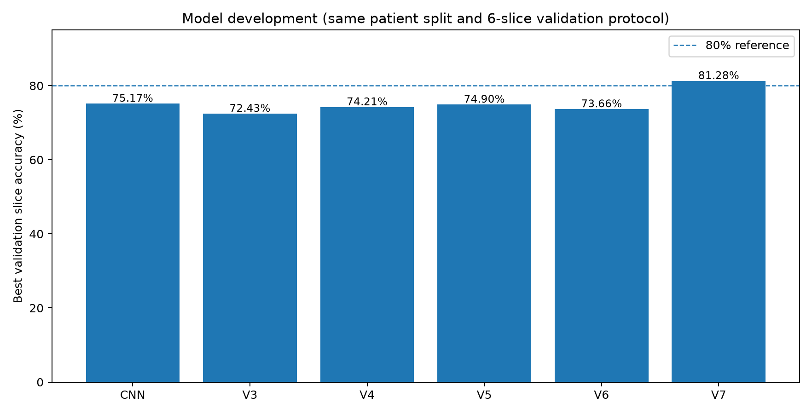
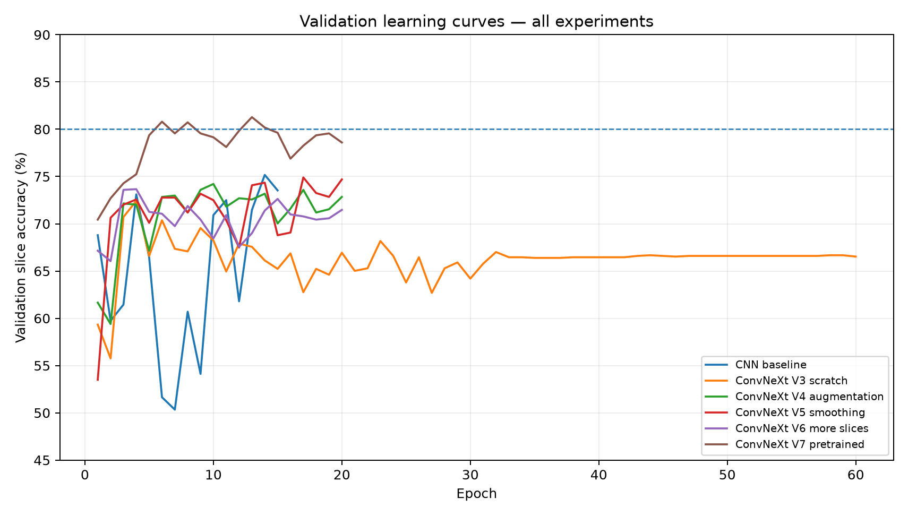
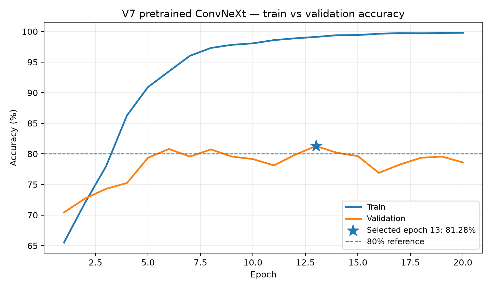
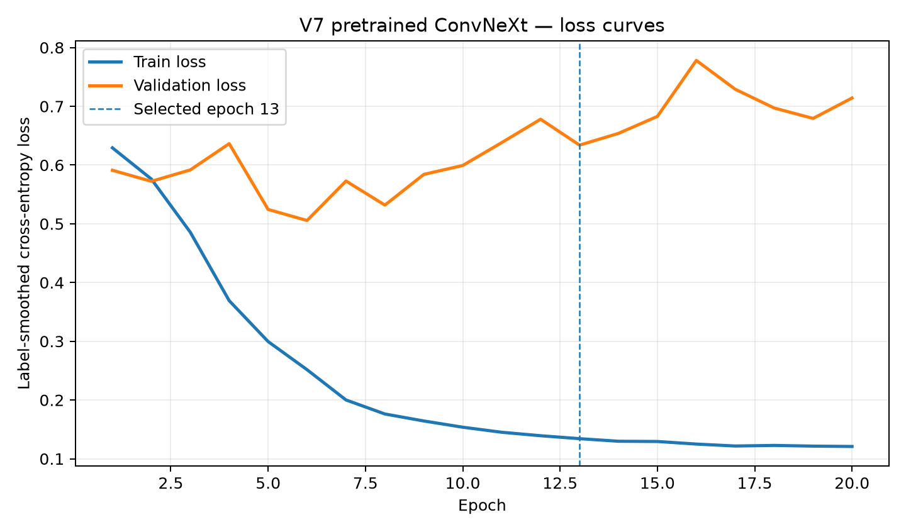
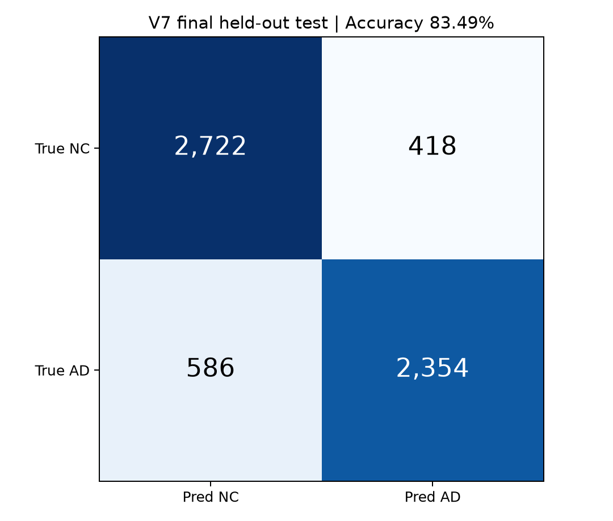
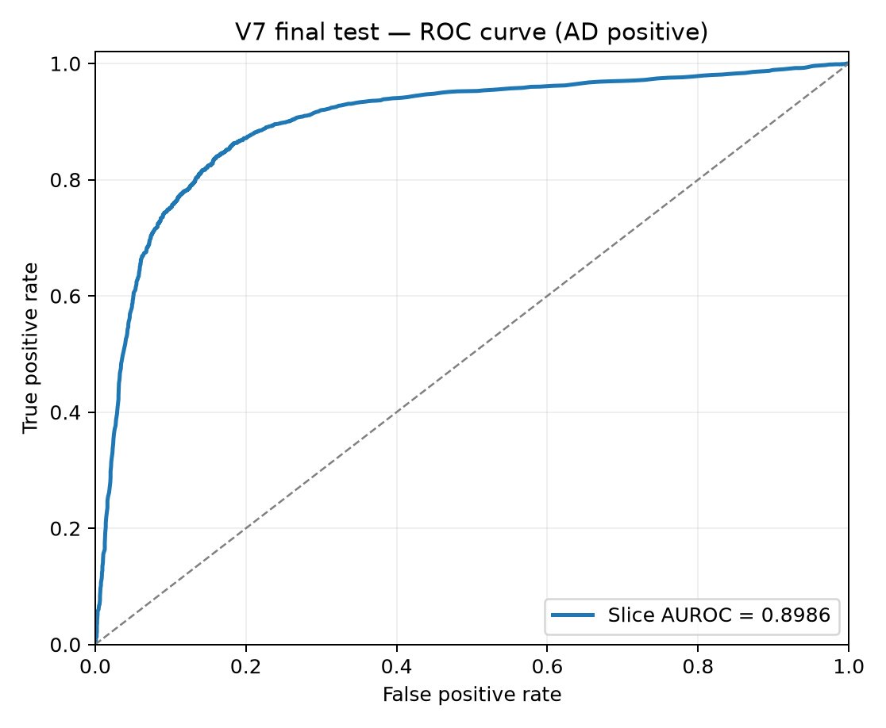
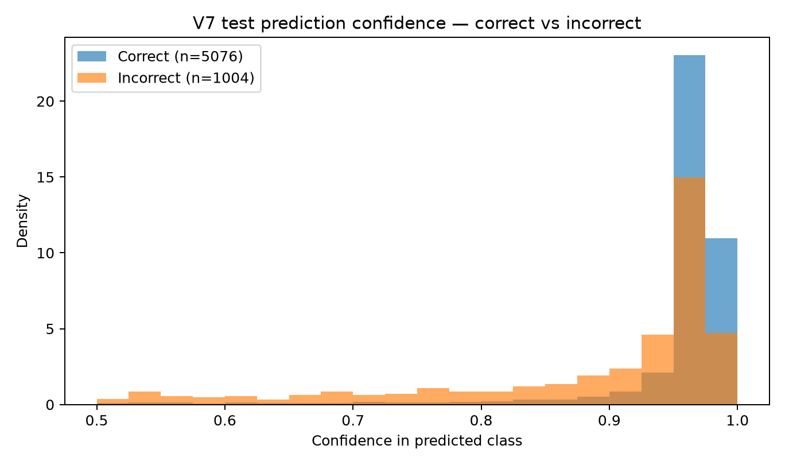
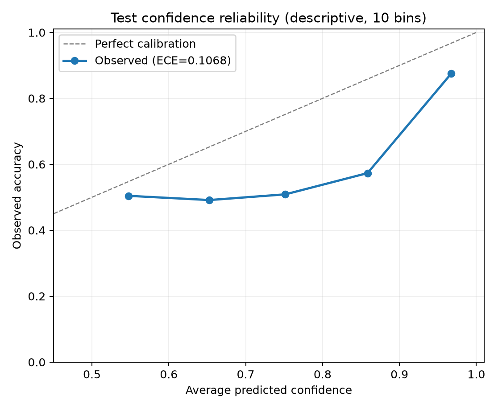

# Patient-Independent Alzheimer's Disease MRI Classification with a Hand-Written ConvNeXt

**COMP3710 Pattern Recognition and Analysis — Recognition Project (Hard)**  
**Student:** s4984947  
**Dataset:** ADNI structural brain MRI, normal control (NC/CN) versus Alzheimer's disease (AD)  
**Final model:** Hand-written ConvNeXt-Tiny-style architecture, ImageNet pretraining and ADNI fine-tuning  
**Locked final checkpoint:** V7, epoch 13, chosen by *validation slice accuracy* before the held-out test
**Matched baseline on same held-out test:** CNN epoch 14, 81.74% slice accuracy

> **Result:** **83.49% slice-level accuracy on the held-out 6,080-slice test set** (137 independent patients). This exceeds the course's ≥80% test-accuracy target. This prototype is a course research demonstration, not a clinical diagnostic device.

## 1. Problem, motivation, and approach

Alzheimer's disease (AD) and cognitively normal (NC) MRI scans can exhibit overlapping anatomy. Automated slice-level classification may assist a human reviewer in prioritising cases, but a high average accuracy can conceal confident mistakes. The engineering problem is therefore not merely to classify AD versus NC, but to examine whether a computationally expensive architecture offers sufficient improvement over a simple CNN, and whether its confidence is reliable enough for a screening workflow. We use the course-provided preprocessed ADNI structural MRI slices and enforce a strict patient-independent data split.

The final architecture is a **hand-written** PyTorch ConvNeXt-style network: four stages with depths `(3, 3, 9, 3)` and widths `(96, 192, 384, 768)`, depth-wise 7×7 convolutions, point-wise MLP transformations, layer scaling, residual connections, and global average pooling. It contains **27,821,666 parameters**. The 1,000-class ImageNet head is replaced by a newly initialised two-class head. To retain the implemented model while benefiting from transferable low- and mid-level representations, `v7_pretrained.py` maps **all 180 pretrained backbone tensors** into the hand-written network with strict shape checks; 1000-class output parity was verified with a maximum absolute difference of 0 on a fixed CPU test input.



## 2. Midpoint Feasibility Review (original check-off document)

*The following reproduces the written feasibility review prepared at the midpoint. It describes the state of the project **at that time**, rather than the final V7 results. The separate page of questions for the tutor is omitted.*

**Project: Alzheimer's Disease Classification from Brain MRI Using ConvNeXt**

### 2.1 User Need, Scope and Acceptance Criteria

This project aims to develop a ConvNeXt-based prototype for classifying brain MRI images into Alzheimer's Disease (AD) and Normal Control (NC). The intended users are medical imaging researchers and clinical specialists.

The main engineering dilemma is whether ConvNeXt improves classification accuracy and confidence reliability compared with a simple CNN, particularly for ambiguous cases.

The acceptance criteria are:

- Prevent patient overlap across training, validation and test sets.
- Target at least 80% test accuracy.
- Compare accuracy, precision, recall, macro-F1 and AUROC against a CNN baseline.
- Analyse 3–5 failure cases and investigate confidence-based referral thresholds.
- Measure model parameters, peak GPU memory and inference latency.

### 2.2 Model Choice and Course Concepts

ConvNeXt is selected as the main architecture because it combines modern convolutional techniques, including depthwise convolutions, residual connections, Layer Normalisation and GELU activation.

A simple CNN will serve as the baseline. Both models will be evaluated on identical patient-independent splits. The project applies course concepts including feature extraction, convolutional neural networks, optimisation and generalisation.

### 2.3 Preliminary Feasibility Evidence

An initial data audit and CPU smoke tests have been completed on Rangpur HPC.

Data audit results:

- 30,520 grayscale JPEG slices (256 × 240 pixels).
- 1,526 MRI scans from 680 distinct patient identifiers.
- 14,860 AD and 15,660 NC slices.
- The original train/test split contains 216 overlapping patient identifiers, indicating a data leakage risk.

A new patient-independent split has been implemented:

| Split | Patients | Image slices |
|---|---:|---:|
| Training | 475 | 21,200 |
| Validation | 102 | 4,560 |
| Testing | 103 | 4,760 |

All three new splits have zero patient overlap. The data loader successfully produces image batches of shape `(4, 3, 224, 224)`.

Model smoke tests: Both the CNN baseline (93,954 parameters) and a small ConvNeXt configuration (232,786 parameters) successfully completed CPU forward-pass tests. Full-scale training and GPU profiling remain pending.

### 2.4 Risks, Computing Budget and Fallback

The main risks include patient-level data leakage, limited GPU availability, overfitting and overconfident incorrect predictions.

Patient-independent splitting has been implemented to address leakage risk. Training will use Rangpur GPU resources, beginning with a small experiment before longer Slurm jobs. If GPU memory becomes insufficient, batch size reduction, mixed precision or a smaller ConvNeXt configuration will be considered.

Next experiment: Integrate the data loader and models into the training pipeline, train the CNN baseline, and benchmark ConvNeXt on the same held-out patient-independent test set.

**Historical-to-final note.** The 475/102/103 split above was the initial midpoint plan. The **final** experiments used a later fixed patient-independent **441/102/137** split (65/15/20) described in Section 3. The original review's statement that GPU training was pending is retained as a historical record, not a statement of current status.

## 3. Data hygiene, preprocessing and leakage prevention

The available ADNI dataset is located at `/home/groups/comp3710/ADNI` on UQ Rangpur. The provided preprocessed set includes **30,520 2D JPEG slices, 1,526 scans and 680 patients** (20 slices per scan). Files from the original `train` and `test` directories are pooled, patient IDs are extracted from metadata, and **patients**, not slices or scans, are deterministically stratified into new subsets with `seed=3710`.

| Partition | Patients | Total slices | NC slices | AD slices |
|---|---:|---:|---:|---:|
| Train (65%) | 441 | 19,580 | 9,960 | 9,620 |
| Validation (15%) | 102 | 4,860 | 2,560 | 2,300 |
| Test (20%) | 137 | 6,080 | 3,140 | 2,940 |

**Cross-split patient overlap is zero.** The reproducible split is implemented in `dataset_v2.py`. The original `dataset.py` remains the image-loading module; `dataset_v4.py` adds augmentation only to the training set. The 65/15/20 split was fixed for the matched final experiments and the independent test cohort was held out from model and threshold selection.

**Input pipeline:** grayscale JPEG → replicate to 3 RGB channels → preserve aspect ratio and pad to `224×224` → scale to `[0,1]` → ImageNet channel normalisation (mean `[0.485,0.456,0.406]`, std `[0.229,0.224,0.225]`). For V4–V7, training only uses light random affine augmentation (±8° rotation, ±4% translation). Validation and test have **no random transformations**. V7 uses six evenly spaced training and validation slices per scan for checkpoint selection; the final test covers **all 20 slices per scan**. The 4,860-slice full validation also verified the chosen V7 checkpoint without changing it.

**No leakage** means no patient appears in more than one partition. Nevertheless, slices from the same patient are correlated, so 6,080 test slices must not be interpreted as 6,080 independent patients. No official model weights, raw MRI files, personal identifiers, or full trained checkpoints should be committed to GitHub.

## 4. Architecture, optimisation, and reproducibility

| Component | Final V7 configuration |
|---|---|
| Network | PyTorch hand-written ConvNeXt, 27.82M parameters |
| Initialisation | Official TorchVision ConvNeXt-Tiny ImageNet-1K weights mapped strictly to handwritten blocks |
| Output | Two logits: NC=0 and AD=1 |
| Loss | Cross entropy with `label_smoothing=0.05` |
| Optimiser | AdamW, `weight_decay=0.01` |
| Batch size | 16 slices (not 16 whole 3D scans) |
| Data | 5,874 training and 1,458 validation slices per epoch; 6 per scan |
| Schedule | 2 head-only epochs, then 18 full-network fine-tuning epochs; cosine learning rate |
| Learning rates | Body `2e-5`; new head `3e-4`; cosine `eta_min=1e-6` |
| Training | 20 epochs, Slurm chain of five 4-epoch GPU jobs; BF16 on A100 |
| Selection | Highest validation *slice* accuracy, tie-break macro-F1 then lower validation loss |
| Final | Epoch 13 `best.pt`; class threshold P(AD) ≥ 0.5 |

A long from-scratch 60-epoch run exposed a severe generalisation gap: training reached 100% while the best slice validation accuracy occurred at epoch 4. V7 transferred pretrained representations and achieved the highest validation accuracy in this experimental series. The model is not fine-tuned on test results.

**Environment verified during development:** Python 3.11.15, PyTorch `2.14.0+cu130`, TorchVision `0.29.0+cu130`, NVIDIA A100 40 GB GPU. Other exact package versions and a minimal pinned requirements file should be captured from the course Conda environment using `python capture_environment.py` (and committed as `environment_versions.json`/`requirements.txt`). The original ImageNet file has verified SHA-256 `983f1562536e84ff750a1576fb08e54de751dbf2e17c0d8a4a13704341fdcd3d` and is available at `https://download.pytorch.org/models/convnext_tiny-983f1562.pth`.

### Project files and reproduction commands

The principal software modules are `modules.py` (CNN and handwritten ConvNeXt), `dataset.py` (image preprocessing), `dataset_v2.py` (locked patient split), `dataset_v4.py` (training augmentation), `train.py` (original baseline utilities), `train_v3_baseline.py` (CNN baseline), `train_v7_finetune.py` (final training and validation entry), `v7_pretrained.py` (pretrained weight mapping), and `predict.py` (inference driver). Additional scripts generate experiment visualisations and locked test benchmarks. `run_*.sbatch` and `submit_v7.sh` launch the existing Rangpur jobs.

```bash
cd ~/PatternAnalysis-2026/recognition/ConvNeXt_ADNI_s4984947
conda activate comp3710-unet
python v7_pretrained.py --verify  # expects official .pth in pretrained/
bash submit_v7.sh               # final training (only if training from scratch)
```

The V7 training script saves `runs/convnext_v7_pretrained20_newsplit/{best.pt,latest.pt,metrics.json}`. Never rerun a finished experiment into its existing output directory unless intentionally resuming from `latest.pt`. Training is not required simply to demonstrate inference if the locked checkpoint is already present.

```bash
# Predict validation examples without changing the model (GPU Slurm or CPU):
python predict.py --split val --examples-per-class 2
# A single ADNI JPEG slice:
python predict.py --image /path/to/ADNI_slice.jpeg
# Additional same-test split model/resource benchmarking, no tuning:
sbatch run_phase4_benchmark.sbatch
# Validation-derived review threshold, then descriptive audit of frozen predictions:
sbatch run_phase4_review_policy.sbatch
```

`predict.py` prints class, P(AD), confidence and ground-truth label if available. Figures are stored under the ignored `runs/predict_examples/` directory. **The trained checkpoint and the ADNI data are deliberately not included in Git.** To reproduce from a fresh checkout, obtain the course dataset and ImageNet weights, then train V7. To reproduce inference from an existing Rangpur run, supply the separately stored `best.pt` checkpoint.

## 5. Experiments: controlled patient split and ablation history

The table below reports the **highest 6-slice-per-scan validation accuracy**, not test accuracy. Training configurations were deliberately changed across experiments; these observations are useful ablations but not all strictly equal-compute comparisons. V6 doubled training slices *and* updates per epoch. No repeated-seed statistical significance is claimed.

| Experiment | Main modification | Epochs | Best epoch | Slice val accuracy | Slice macro-F1 | Patient val accuracy |
|---|---|---:|---:|---:|---:|---:|
| CNN baseline V3 | simple 0.094M-param CNN | 15 | 14 | **75.17%** | 0.7475 | 80.39% |
| ConvNeXt V3 | scratch, long training | 60 | 4 | 72.43% | 0.7234 | 71.57% |
| ConvNeXt V4 | light MRI affine augmentation | 20 | 10 | 74.21% | 0.7406 | 82.35% |
| ConvNeXt V5 | V4 plus label smoothing | 20 | 17 | 74.90% | 0.7484 | 77.45% |
| ConvNeXt V6 | V5 with 12 instead of 6 training slices/scan | 20 | 4 | 73.66% | 0.7352 | 75.49% |
| **ConvNeXt V7** | **V5 plus pretraining, head warmup & fine-tuning** | **20** | **13** | **81.28%** | **0.8110** | **86.27%** |






The V7 checkpoint selected from the 1,458-slice validation subset retained **81.32%** accuracy when evaluated on all **4,860 validation slices**; macro-F1 was **0.8114** and patient accuracy was **86.27%**. The best epoch was **13**, not the final epoch 20. The later training accuracy approached 100% and validation performance declined, supporting early checkpoint selection based only on validation outcomes.

## 6. Final held-out test (locked V7 checkpoint)

The final test comprised 137 independent patients and all 6,080 held-out slices. These numbers refer to the fixed V7 epoch-13 checkpoint, default classification threshold **0.5**, and no subsequent model or hyperparameter tuning. **Test slice accuracy = 83.49%**, exceeding the course target by 3.49 percentage points.

| Final test metric | Value |
|---|---:|
| Slice accuracy | **83.49%** (5,076 / 6,080) |
| Slice AUROC | **0.8986** |
| Slice macro-precision / macro-recall / macro-F1 | 0.8360 / 0.8338 / **0.8343** |
| Patient accuracy | **89.78%** (123 / 137) |
| Patient AUROC | **0.9220** |
| NC precision / recall / F1 | 0.8229 / 0.8669 / 0.8443 |
| AD precision / recall / F1 | 0.8492 / 0.8007 / 0.8242 |
| Brier score | 0.1380 |
| ECE (10 confidence bins) | **0.1068** |
| Confusion matrix [TN, FP, FN, TP] | [2,722, 418, 586, 2,354] |




### Matched CNN baseline benchmark on the same held-out test cohort

Both checkpoints were fixed using validation alone and evaluated once on the **same 137 held-out patients and 6,080 test slices** with the same 0.5 decision threshold and preprocessing. The following figures are from `runs/phase4_benchmark/benchmark.json`; they are **test**, not validation, measurements. The number of correctly predicted slices was 4,970 for CNN versus 5,076 for V7 (106 additional correctly predicted slices).

| Metric (same 6,080-slice test) | CNN baseline (epoch 14) | ConvNeXt V7 (epoch 13) |
|---|---:|---:|
| Slice accuracy | 81.74% | **83.49%** |
| Slice macro-F1 | 0.8172 | **0.8343** |
| Slice AUROC | 0.8931 | **0.8986** |
| Patient accuracy (137 patients) | 81.75% (112/137) | **89.78% (123/137)** |
| Patient AUROC | 0.8621 | **0.9220** |
| NC recall | 82.71% | **86.69%** |
| AD recall | **80.71%** | 80.07% |
| NC false positives (NC→AD slices) | 543 | **418** |
| AD false negatives (AD→NC slices) | **567** | 586 |
| ECE (10 confidence bins; lower better) | **0.0564** | 0.1068 |
| Brier score (lower better) | **0.1343** | 0.1380 |
| Parameter count | **93,954** | 27,821,666 |
| GPU forward time per slice, batch 16 | **0.130 ms** | 0.572 ms |
| Total benchmark inference time (6,080 slices) | **9.39 s** | 10.42 s |
| End-to-end inference throughput | **647.6 slices/s** | 583.5 slices/s |
| Peak GPU memory reserved during inference | **0.168 GB** | 0.324 GB |

**Accuracy–safety trade-off:** V7 achieves +1.74 percentage points in slice accuracy, but the gain consists of 125 more correctly classified normal (NC) slices while **19 additional AD slices are missed** relative to CNN. In a screening scenario, the AD false-negative cost cannot be ignored. V7's better AUROC and aggregate accuracy also do **not** mean better probability calibration: CNN has the lower ECE and Brier score. As an inference-cost trade-off, V7 has approximately **296×** as many parameters and **4.4×** GPU-only forward time per slice, although the measured end-to-end total time differs by only about **11%** due to shared data-loading/overhead. These are single A100 benchmark measurements, not statistical inference about other hardware. Parameter count and forward latency are different computational quantities; peak reserved GPU memory above is **inference**, not training, VRAM.

## 7. Engineering dilemma: confidence, ambiguity, and failure autopsy

Average accuracy is not sufficient for medical triage. The final model has **1,004 incorrect test slices**, comprising 418 NC→AD false positives (FP) and 586 AD→NC false negatives (FN). NC recall is 86.69% but AD recall is 80.07%, a clinically relevant asymmetry. A false-negative *slice* is **not** a diagnosed missed patient: many slices belong to the same scan and patient.




Three high-confidence FP and three high-confidence FN examples were chosen from **different patients within each error category**, selected by wrong-prediction confidence rather than by visual attractiveness. Their anonymised slice indices and probabilities are:

| Error | Anonymised slice index | True → predicted | P(AD) | Confidence in wrong class |
|---|---:|---|---:|---:|
| FP | 1664 | NC → AD | 0.9864 | 0.9864 |
| FP | 397 | NC → AD | 0.9848 | 0.9848 |
| FP | 1009 | NC → AD | 0.9837 | 0.9837 |
| FN | 3868 | AD → NC | 0.0170 | 0.9830 |
| FN | 5432 | AD → NC | 0.0178 | 0.9822 |
| FN | 6069 | AD → NC | 0.0181 | 0.9819 |

These cases demonstrate **confident mistakes**, not just predictions near 0.5. The corresponding MRI panels were examined and stored in the private course evidence pack, but **patient-derived MRI images are intentionally excluded from this public README pending dataset redistribution clearance**. No anatomical cause is asserted without expert assessment: brain morphology, atrophy pattern, slice position, and acquisition differences remain hypotheses rather than validated causal explanations. The examples also show why rejecting *only* low-confidence predictions does not guarantee elimination of unsafe errors.

**Calibration:** ECE=0.1068 over ten confidence bins indicates a measurable gap between average confidence and observed correctness; it is a summary metric, not a guarantee at any individual confidence. AUROC=0.8986 shows useful slice ranking ability but does not establish calibration. The matched baseline test comparison above finds **better probability calibration in the simpler CNN** (ECE 0.0564 versus V7 0.1068), even though V7 has slightly better AUROC (0.8986 versus 0.8931). Therefore V7 has no demonstrated confidence-reliability advantage over CNN at the evaluated operating point.

### Validation-only human-review/reject-option audit

A transparent decision rule was investigated: for a slice, compute predicted-class confidence `max(P(AD), 1-P(AD))`; automatically accept the classification only when confidence is at least **τ**, otherwise refer the slice to human review. The exploratory threshold grid in `review_policy.py` covered τ = 0.50, 0.51, ..., 0.99, with criteria of **≥90% validation accuracy on automatically accepted slices** and **≥20% validation coverage**. This supplementary rule analysis was devised **after the final model test was already reported**, so it is not a prospective, preregistered policy assessment. Threshold selection was conducted strictly on the **4,860 validation slices** using `review_policy.py`.

**Result: no candidate threshold met both conditions.** The generated `runs/phase4_benchmark/review_rule.json` records `"validation": null`; therefore **no operational automated-acceptance threshold was selected**, and no held-out selective-accuracy claim is reported. This is a substantive negative result rather than a software error. A confidence-only reject option does not support the predefined ≥90%-accuracy/≥20%-coverage target on these validation data. The scripted threshold search did **not** use test predictions for threshold selection; nevertheless its retrospective timing limits any independent safety claim. Any further threshold investigation must be labelled exploratory and should not be presented as a validated clinical policy. In this prototype, uncertain *and* confidently wrong cases require expert oversight; automatic clinical clearance is **not recommended**.

The validation requirement is deliberately conservative: because slices from a patient are correlated, a slice-level accepted-accuracy estimate cannot establish patient-level safety. Even an accepted-case accuracy target is not a clinical sensitivity requirement, and the six high-confidence misclassified test examples show why a threshold alone may be insufficient.

### Manager recommendation and limitations

**Recommendation:** advance V7 as a controlled research prototype, **not** a stand-alone clinical screening system. Its 83.49% held-out accuracy clears the course acceptance threshold, but residual AD false negatives, high-confidence incorrect predictions, calibration error, limited independent patient sample size, and possible differences across scanners and institutions mean that human oversight and external validation remain essential. Before deployment, evaluate a validation-derived abstention rule at **patient level**, conduct external-center testing, verify uncertainty calibration, measure latency and resource budgets, and seek radiologist/neurologist review of failure triggers. The 28M-param backbone is substantially more expensive than the 94K-param CNN: the matched benchmark shows **296×** the parameters and **4.4×** the GPU-only per-slice forward latency for a **+1.74-point** slice-accuracy benefit, with **worse calibration and 19 more AD false-negative slices**. This does not currently justify unsupervised clinical automation, despite satisfying the course accuracy requirement. The next research priority is patient-level error auditing, external validation and calibration assessment rather than further optimisation on the locked test set.

## 8. Artificial Intelligence Usage Disclosure

**AI tools:** OpenAI ChatGPT was used as a coding, debugging, experiment-design and report-writing assistant. It assisted with initial code scaffolding, bash/Slurm commands, dataset split checks, the weight-mapping and checkpoint workflow, Python metric/visualisation scripts, README drafting and explanations of technical concepts. This assistance does **not** replace independent verification or the student's responsibility for the work.

**Verification and personal responsibility:** The student inspected the code, executed the experiments on Rangpur, confirmed the absence of patient overlap, checked all stages' Slurm exit statuses, used a fixed seed and locked checkpoint before test evaluation, verified official weight SHA256 and output parity of the hand-written and official models, compared test metrics against a fixed confusion matrix, and reviewed resulting figures/metrics. AI-generated code or prose should be reviewed by the student before final submission. No code was copied from other students.

## 9. References and provenance

1. Z. Liu et al., **A ConvNet for the 2020s**, CVPR 2022. https://arxiv.org/abs/2201.03545
2. TorchVision, **ConvNeXt-Tiny weights and model implementation**. https://pytorch.org/vision/stable/models/convnext.html
3. Alzheimer's Disease Neuroimaging Initiative (ADNI), course-provided MRI dataset: `/home/groups/comp3710/ADNI`.
4. UQ COMP3710/COMP7710, **Report: Pattern Recognition, version 2.5**, Sections 2.1, 3, 4, 5 and 6.

**Figure provenance:** the eight included plots were generated from locked experiment metrics and V7 final predictions using `phase2_make_training_plots.py` and `phase2_final_test_visuals.py` (saved under `runs/phase2_final_analysis/` on Rangpur). Original MRI case panels and test prediction CSV remain in private `runs/` and are deliberately excluded from the public repository. Numbers are retained without post-test optimisation.

---

**Final submission verification (not part of the model's performance claim):** The feasibility review above is transcribed from the midpoint document supplied for this project; record the exact package versions from `python capture_environment.py` and include the resulting `requirements.txt`/`environment_versions.json`; verify the final `predict.py`, V7 source, images permitted for redistribution, and all required scripts are committed. The same `README.md` must be exported to PDF for the Turnitin submission and included unchanged in the upstream `topic-recognition` PR. Do not upload `runs/`, MRI images or model checkpoint files to a public repository.
